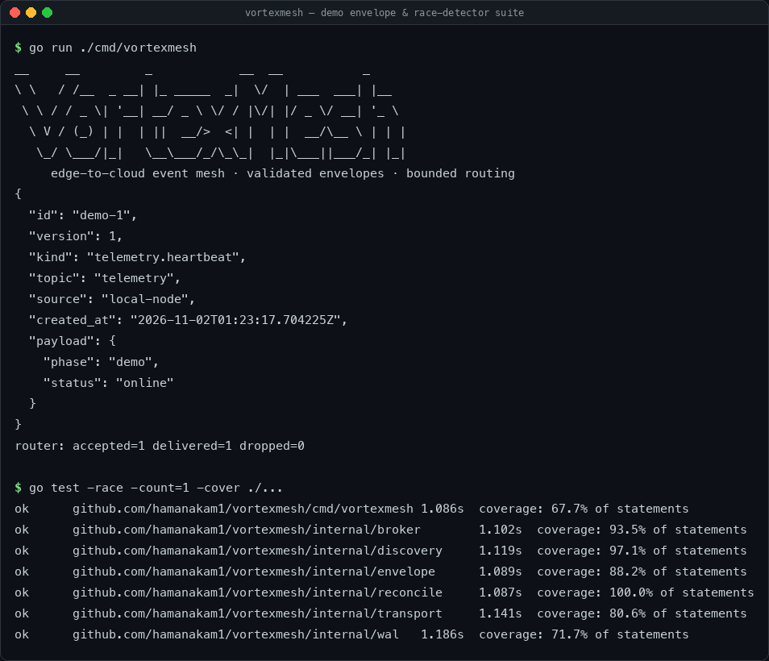

# VortexMesh

```text
__     __         _            __  __           _
\ \   / /__  _ __| |_ _____  _|  \/  | ___  ___| |__
 \ \ / / _ \| '__| __/ _ \ \/ / |\/| |/ _ \/ __| '_ \
  \ V / (_) | |  | ||  __/>  <| |  | |  __/\__ \ | | |
   \_/ \___/|_|   \__\___/_/\_\_|  |_|\___||___/_| |_|
```

<p align="center">
  <em>A small, inspectable event mesh for agents and edge nodes that must keep
  working across slow, intermittent, or disconnected links.</em>
</p>

<p align="center">
  <a href="https://github.com/hamanakam1/VortexMesh/actions/workflows/ci.yml"></a>
  
  
  <a href="https://github.com/hamanakam1/VortexMesh/releases"></a>
</p>

VortexMesh is a learning-oriented distributed event mesh written in Go. It is
built for local agent swarms, central services, and links that disappear for
minutes at a time — satellite backhaul, field hardware, flaky Wi-Fi.

Every layer is deliberately small enough to read in one sitting, and every
claim in this README is backed by a test you can run.



---

## Quick start

Requires Go 1.23 or newer. There is no cgo dependency; SQLite is the pure-Go
`modernc.org/sqlite` driver, so cross-compilation works out of the box.

```sh
git clone https://github.com/hamanakam1/VortexMesh.git
cd VortexMesh

go test ./...                 # full suite, no network access needed
go test -race ./...           # what CI runs
go run ./cmd/vortexmesh       # self-contained demo
```

The demo prints the banner, one validated telemetry envelope, and the router
counters:

```text
{
  "id": "demo-1",
  "version": 1,
  "kind": "telemetry.heartbeat",
  "topic": "telemetry",
  "source": "local-node",
  "created_at": "2026-10-30T04:06:23.089231Z",
  "payload": {
    "phase": "demo",
    "status": "online"
  }
}
router: accepted=1 delivered=1 dropped=0
```

Use `-topic` to publish to a different topic:

```sh
go run ./cmd/vortexmesh -topic agents/worker-1
```

---

## Why this exists

Most "offline-first" demos skip the hard parts: what happens when the buffer is
full, when the same message arrives twice, or when two nodes edit the same state
during a partition. VortexMesh makes those cases the actual subject:

- **Bounded everywhere.** No unbounded queues. A slow consumer produces
  backpressure or a counted drop, never silent memory growth.
- **Validated at every boundary.** One `Envelope.Validate` is reused by the
  broker, the write-ahead log, and the transport, so a malformed message cannot
  enter the system by a side door.
- **Idempotent by construction.** Message IDs are unique in the WAL, so a retry
  after a lost acknowledgment cannot duplicate work.
- **Honest about what is missing.** The status table below distinguishes
  implemented code from planned work.

---

## Architecture

```text
                    envelope.New / envelope.Decode
                                │
              ┌─────────────────┼──────────────────┐
              ▼                 ▼                  ▼
        ┌──────────┐      ┌──────────┐      ┌────────────┐
        │   wal    │      │  router  │      │ transport  │
        │ replay   │      │ bounded  │      │  QUIC +    │
        │ offline  │      │ workers  │      │  mTLS 1.3  │
        └──────────┘      └────┬─────┘      └─────┬──────┘
                                 ▼                │
                          ┌──────────────┐        │
                          │    broker    │◀───────┘
                          │ topic fan-out│
                          └──────┬───────┘
                                 ▼
                            subscribers
```

Each package has one job and no upward dependencies:

| Package | Responsibility | Key type |
| --- | --- | --- |
| [`internal/envelope`](internal/envelope) | Versioned message format and validation | `envelope.Envelope` |
| [`internal/broker`](internal/broker) | In-process pub/sub and bounded worker routing | `broker.Broker`, `broker.Router` |
| [`internal/wal`](internal/wal) | SQLite write-ahead log for offline replay | `wal.Store` |
| [`internal/reconcile`](internal/reconcile) | Vector clocks and heartbeat state | `reconcile.VectorClock`, `reconcile.Machine` |
| [`internal/discovery`](internal/discovery) | Peer advertisement and TTL expiry | `discovery.Registry` |
| [`internal/transport`](internal/transport) | QUIC + mutual TLS 1.3 framing | `transport.Server` |
| [`cmd/vortexmesh`](cmd/vortexmesh) | Runnable demo | `main` |

Deeper notes: [`docs/architecture.md`](docs/architecture.md) and
[`docs/protocol.md`](docs/protocol.md).

---

## Delivery status

The status table is the contract for this project. An unchecked item is a goal,
not an implied feature.

| Phase | Concern | Status | Evidence |
| --- | --- | --- | --- |
| 1 | Versioned envelopes and strict validation | **Implemented** | `internal/envelope` tests, incl. trailing-data and invalid-payload rejection |
| 2 | QUIC transport with TLS 1.3 mutual auth | **Implemented** | `TestEndToEndMutualTLS` performs a real handshake with generated certs |
| 3 | Concurrent pub/sub with bounded routing and metrics | **Implemented** | `internal/broker` tests, incl. backpressure and shutdown |
| 4 | SQLite-backed offline write-ahead log | **Implemented** | `internal/wal` tests, incl. idempotent append and ordering |
| 5 | Heartbeats and vector-clock reconciliation | **Implemented** | `internal/reconcile` tests, incl. concurrent state access |
| 6 | Peer discovery interface | **Implemented (in-memory)** | `internal/discovery` tests; mDNS/gossip adapters not written |
| 7 | RBAC, topic ACLs, and token verification | Planned | — |
| 8 | Partition, loss, and latency chaos tests | Planned | — |
| 9 | Scratch container and systemd service | Planned | — |
| 10 | Operator CLI for peers, queues, bandwidth, and sync | Planned | — |

### What is deliberately not here yet

Being explicit protects you from assuming more than the code does:

- There is no daemon that wires the WAL, transport, and reconciliation loop
  together end to end. Each boundary is implemented and tested on its own.
- No authorization layer exists. A valid client certificate can publish to any
  topic.
- Vector clocks are computed correctly but are not persisted or gossiped.
- Discovery ships an in-memory registry only; it is not a working mDNS
  implementation.

---

## Design guarantees

**Validation is unavoidable.** `Envelope.MarshalJSON` refuses to serialise an
invalid envelope, and `envelope.Decode` validates anything coming off the wire
or out of SQLite. You cannot construct a bad message through the public API.

**Backpressure is a counted outcome.** A full queue either blocks until the
caller's context expires or increments `Dropped`. There is no silent discard
path.

**Shutdown cannot panic.** Subscribers are closed under a lock that publishers
hold during send, and the router cancels in-flight work before taking its write
lock. Both races have regression tests that run under `-race`.

**Ordering is stable.** The WAL replays by monotonic sequence, and
`discovery.Registry.Peers` returns results sorted by peer ID rather than Go's
randomised map order.

**Framing is bounded.** `transport.ReadEnvelope` rejects empty frames and
anything over 4 MiB *before* allocating, so a hostile peer cannot force an
unbounded read.

---

## The envelope

```json
{
  "id": "m-1",
  "version": 1,
  "kind": "task.request",
  "topic": "agents/a1",
  "source": "node-a",
  "created_at": "2026-10-30T04:06:23.089231Z",
  "payload": { "action": "sync" }
}
```

`kind` is one of `task.request`, `telemetry.heartbeat`, or `state.sync`.
`payload` is opaque JSON — the mesh never needs your application schema.
Anything that fails validation is rejected before it is published, framed, or
persisted.

---

## Roadmap

1. ~~Envelope schema and validation~~ ✅
2. ~~QUIC transport with mTLS~~ ✅
3. ~~Concurrent pub/sub routing with bounded workers~~ ✅
4. ~~SQLite offline WAL~~ ✅
5. ~~Heartbeat and vector-clock reconciliation~~ ✅
6. ~~Peer discovery interface~~ ✅
7. Authorization: topic ACLs and token verification
8. Chaos tests for partitions, loss, and latency
9. Container image and systemd unit
10. Operator CLI

---

## Contributing

Issues and pull requests are welcome. Please run the same checks CI runs:

```sh
make check     # gofmt, vet, build, test -race
```

See [`CONTRIBUTING.md`](CONTRIBUTING.md) for conventions, and
[`SECURITY.md`](SECURITY.md) for how to report a vulnerability privately.

---

## License

[MIT](LICENSE) © 2026 hamanakam1
